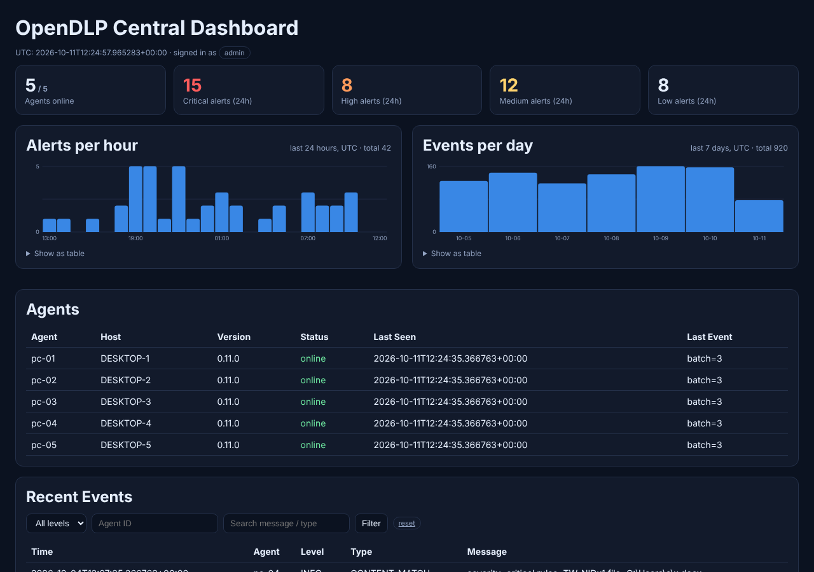

# Leakwarden v0.13.0

*Formerly OpenDLP.* Open-source **endpoint data-loss-prevention (audit & detection)** for small and medium businesses: agents for **Windows, macOS and Linux**, a watchdog, and a FastAPI central server with dashboard. It is an **audit-first prototype**, not a finished commercial DLP product.

[繁體中文說明](README.zh-TW.md) · [Changelog](CHANGELOG.md) · [Security policy](SECURITY.md)



## Download

**[⬇ Latest release](../../releases/latest)** - ready-to-install packages, no compiler needed:

| Platform | File | Install |
|---|---|---|
| Windows 10/11 (x64) | `Leakwarden-windows-x64-<version>.zip` | extract, elevated PowerShell in `agent`: `.\install-service.ps1 -ServerUrl ... -EnrollmentCode ... -WithWatchdog` |
| macOS Apple Silicon / Intel | `Leakwarden-macos-arm64-…` / `Leakwarden-macos-x64-….tar.gz` | extract, `sudo ./leakwarden-agent/install.sh --server-url ... --enrollment-code ...` |
| Linux x64 (systemd) | `Leakwarden-linux-x64-<version>.tar.gz` | same as macOS |
| Chrome / Edge | `Leakwarden-browser-extension-<version>.zip` | publish to your Web Store / Add-ons account or load unpacked - see [browser-extension/README.md](browser-extension/README.md) |
| Many machines | `Deploy-Leakwarden.ps1`, `deploy-leakwarden.sh` | see [docs/DEPLOYMENT.md](docs/DEPLOYMENT.md) or the dashboard's **Deploy agents** page |
| Server | this repository | `docker compose up -d` - see [docs/QUICKSTART-SMB.md](docs/QUICKSTART-SMB.md) |

Verify downloads with `SHA256SUMS.txt` from the same release.

> **Verification status:** every change is built and tested automatically on clean Windows VMs — unit tests, a console end-to-end test and a full Windows-service install/detect/recover/uninstall test (see [docs/RELEASE_AUDIT.md](docs/RELEASE_AUDIT.md)). USB devices and the interactive clipboard are not covered by automation yet; reports from real machines are very welcome.
>
> **Limitations:** Current features focus on auditing, content detection and event reporting. USB, clipboard, print and browser policy fields do **not** mean reliable OS-level blocking exists in every scenario. Do not rely on Leakwarden as your only line of defense against data leakage.

**New here?** Read [docs/QUICKSTART-SMB.md](docs/QUICKSTART-SMB.md) — server + first PC in ~15 minutes. Rolling out to many machines: [docs/DEPLOYMENT.md](docs/DEPLOYMENT.md). Compliance notes: [docs/COMPLIANCE.md](docs/COMPLIANCE.md).

## Features

- **Agent (.NET 8, Windows):** file-activity monitoring on configured paths, content inspection of supported text/Office files (payment cards, IBAN, US SSN, passports in 9 languages, API keys/tokens, private keys, Taiwan national ID, bulk phone/e-mail, multilingual keywords, custom regex), removable-drive events, print auditing (PrintService log), clipboard monitoring via a user-session helper, encrypted local log with a durable upload outbox.
- **Server (FastAPI + SQLite):** telemetry ingestion, signed policy distribution (HMAC + optional ECDSA) with versioning, **agent self-enrollment** with per-machine tokens and revocation, admin/viewer roles, dashboard with severity tiles, hourly/daily charts and filters, **monthly PDF report** (download or automatic e-mail), CSV export, **Slack/Teams/webhook and e-mail alerts**, age-based retention, one-command HTTPS deployment.
- **Browser extension (Chrome / Edge):** warns about or blocks pasting and uploading sensitive data into AI chats, personal cloud drives and file-sharing sites. See [browser-extension/README.md](browser-extension/README.md).
- **File fingerprints:** register confidential files; exact copies are recognised everywhere, even renamed or inside a zip.
- **Cloud drive scanning (report-only):** Google Workspace and Microsoft 365 files shared with "anyone with the link" that contain sensitive data. See [docs/CLOUD-SCAN.md](docs/CLOUD-SCAN.md).
- **Optional AI classification** with a model you host yourself. See [docs/AI-CLASSIFICATION.md](docs/AI-CLASSIFICATION.md).
- **Text in images (OCR):** screenshots and photos of ID cards are read on the device (built-in Windows OCR, Tesseract on macOS/Linux). **Screen watermark** (Windows) with user, host and date. See [docs/OCR-AND-WATERMARK.md](docs/OCR-AND-WATERMARK.md).
- **Outbound e-mail scanning (report-only):** mail sent outside the organisation with sensitive data or fingerprinted attachments (Microsoft 365, Gmail). See [docs/EMAIL-SCAN.md](docs/EMAIL-SCAN.md).
- **Audit & enterprise integration:** tamper-evident (HMAC-chained) event and admin-action log, SIEM forwarding (syslog CEF/JSON over UDP/TCP/TLS), department/group policies, dashboard single sign-on with Microsoft Entra ID, Google, Okta or any OpenID Connect provider. See [docs/ENTERPRISE.md](docs/ENTERPRISE.md).
- **macOS / Linux agent:** same detection engine, removable-volume auditing, launchd / systemd service with automatic restart.
- **Watchdog (Windows):** restarts the service when it stops or its heartbeat goes stale.
- **Fleet deployment:** silent, checksum-verified, idempotent deploy scripts for Intune, Group Policy, RMM, Jamf, Kandji, SSH and Ansible; a dashboard page generates the commands.

## Project layout

```text
Leakwarden/
├── agent/                  .NET 8 Windows endpoint agent (+ install scripts)
├── agent.tests/            xunit tests for the agent
├── agent-unix/             macOS / Linux agent (shares the detection core) + install.sh
├── deploy/                 fleet deployment scripts (Windows, macOS/Linux) and Caddyfile
├── tests/e2e/              end-to-end tests run in CI on clean Windows, macOS and Linux VMs
├── watchdog/               Agent watchdog prototype
├── server/                 FastAPI API + dashboard
├── policies/default-policy.json
├── docs/RELEASE_AUDIT.md
├── CHANGELOG.md
├── SECURITY.md
└── LICENSE                 GPL-3.0-only
```

## Requirements

- Windows agent: Windows 10 (1809 or later) / 11 x64 (release packages are self-contained). Building from source: .NET 8 SDK.
- macOS agent: macOS 12+ (Apple Silicon or Intel). Linux agent: x64 with systemd.
- Server: Python 3.10+.

## Run the central server (development)

Linux/macOS:

```bash
cd server
python -m venv .venv
. .venv/bin/activate
pip install -r requirements.txt
export LEAKWARDEN_TOKEN="a random secret of at least 32 bytes"          # used by agents
export LEAKWARDEN_ADMIN_TOKEN="another random secret, >= 32 bytes"      # read events / agent list
export LEAKWARDEN_DASHBOARD_PASSWORD="your dashboard password"          # dashboard is disabled if unset
uvicorn main:app --host 127.0.0.1 --port 8000
```

Windows PowerShell:

```powershell
cd server
py -m venv .venv
.\.venv\Scripts\Activate.ps1
pip install -r requirements.txt
$env:LEAKWARDEN_TOKEN = "a random secret of at least 32 bytes"
$env:LEAKWARDEN_ADMIN_TOKEN = "another random secret, >= 32 bytes"
$env:LEAKWARDEN_DASHBOARD_PASSWORD = "your dashboard password"
uvicorn main:app --host 127.0.0.1 --port 8000
```

Generate secrets with `python -c "import secrets; print(secrets.token_urlsafe(48))"`.

Dashboard: <http://127.0.0.1:8000/> (HTTP Basic, user `admin`). Use HTTPS (e.g. a TLS reverse proxy) outside of local testing. All environment variables are listed in `server/env.example`.

### API overview

| Endpoint | Auth | Purpose |
|---|---|---|
| `POST /api/v1/telemetry` | Agent token + `X-Agent-Id` | Upload event batches |
| `GET /api/v1/policy?version=N` | Agent token + `X-Agent-Id` | Signed policy; `304` if up to date |
| `GET /api/v1/events` | Admin token | List recent events |
| `GET /api/v1/agents` | Admin token | List agents and last-seen time |
| `POST /api/v1/enroll` | enrollment code | Self-enroll; returns a per-machine token |
| `GET /api/v1/stats`, `/stats/timeseries`, `/events.csv`, `/reports/monthly.pdf` | Admin or viewer token | Statistics, chart data, CSV export, monthly PDF report |
| `GET/PUT /api/v1/admin/policy` | viewer / admin | Read / replace the policy (validated) |
| `POST /api/v1/admin/agents/{id}/revoke`, `/unrevoke`, `DELETE …/agents/{id}` | Admin token | Agent lifecycle |
| `POST /api/v1/admin/notify/test` | Admin token | Send a test alert to webhook / e-mail |
| `GET/POST /api/v1/admin/fingerprints`, `DELETE …/{sha256}` | viewer / admin | Confidential-file fingerprint registry |
| `GET /api/v1/admin/cloudscan`, `POST …/cloudscan/run` | viewer / admin | Cloud drive scan status / run now |
| `GET /api/v1/admin/groups`, `PUT/DELETE …/groups/{name}`, `POST …/agents/{id}/group`, `GET …/agents/{id}/effective-policy` | viewer / admin | Department / group policies |
| `GET /api/v1/admin/emailscan`, `POST …/emailscan/run` | viewer / admin | Outbound e-mail scan status / run now |
| `GET /api/v1/admin/audit/verify` | viewer / admin | Verify the tamper-evident log |
| `GET /api/v1/admin/siem` | viewer / admin | SIEM forwarding status |
| `GET /health` | none | Liveness check |

The default policy is `policies/default-policy.json` (override with `LEAKWARDEN_POLICY`). It is validated before being signed. Policies are signed with HMAC-SHA256 using a key derived from the agent's token — a shared-secret prototype design, not asymmetric signing. Use TLS and protect your tokens.

### Docker

```bash
cp server/env.example .env      # fill in the secrets
docker compose up -d             # server on 127.0.0.1:8000; put a TLS reverse proxy in front for remote access
```

Public HTTPS with automatic certificates: `LEAKWARDEN_DOMAIN=dlp.example.com docker compose --profile https up -d`.

## Configure and run the Agent

**Recommended (self-enrollment):** download `Leakwarden-windows-x64-vX.Y.Z.zip` from [Releases](../../releases), extract it, and in an elevated PowerShell in the `agent` folder run:

```powershell
.\install-service.ps1 -ServerUrl https://dlp.example.com -EnrollmentCode "<LEAKWARDEN_ENROLL_CODE from the server .env>" -WithWatchdog
```

The agent exchanges the code for its own token on first start and stores it encrypted (DPAPI, machine scope). Revoke a machine any time via the admin API.

**Manual / development:**
1. Copy `agent.config.example.json` to `agent.config.json`; set `ServerUrl` and either `EnrollmentCode` or `ApiToken` (or the `LEAKWARDEN_TOKEN` env var). Never commit a real token.
2. Run:

```powershell
dotnet build
dotnet run -- --mode console
```

Uninstall: `& "C:\Program Files\Leakwarden\uninstall-service.ps1"`.

**macOS / Linux:** download `Leakwarden-macos-arm64|macos-x64|linux-x64-vX.Y.Z.tar.gz`, extract, then `sudo ./leakwarden-agent/install.sh --server-url https://dlp.example.com --enrollment-code "<code>"`. On macOS grant the agent Full Disk Access (see [docs/DEPLOYMENT.md](docs/DEPLOYMENT.md)).

**Many machines:** see [docs/DEPLOYMENT.md](docs/DEPLOYMENT.md) or the dashboard's **Deploy agents** page.

**Asymmetric policy signing (recommended):** on the server run `python tools/gen_signing_key.py /etc/leakwarden/policy-signing.pem`, set `LEAKWARDEN_SIGNING_KEY` to that path, and paste the printed public key into each agent's `PolicySigningPublicKey`. Agents then reject any policy not signed by the server's private key, even if the shared token leaks.

Windows modes: `--mode console` (development), `--mode service` (installed service), `--mode helper` (per-user clipboard helper).

Local logs may contain file paths and other sensitive information. Test only on authorized devices and check your organization's policy and applicable law first.

## Testing

```bash
cd server
pip install -r requirements-dev.txt
python -m pytest -q
```

Agent unit tests (Windows, .NET 8 SDK): `dotnet test agent.tests/Leakwarden.Agent.Tests.csproj`

GitHub Actions (`.github/workflows/ci.yml`) runs on every push: server tests, Docker build, Windows agent build + unit tests, and end-to-end tests on clean **Windows, macOS and Linux** VMs (fleet deploy script, service install, enrollment, signed policy, detection in text/Word/Excel files, printing, crash recovery, uninstall). Pushing a `v*` tag publishes packages for all platforms to Releases.

For manual Windows testing, also cover: valid/invalid token, bad policy signature, offline retry, log retention, helper IPC permissions, and service start/stop.

## Leakwarden Deploy Kit (paid, optional)

Leakwarden is free and complete: every feature above is in the open-source edition. The **Deploy Kit** is for people who want to save time. It runs on **your own server**, and is a subscription to always-current rollout tooling:

- **One-command server install** on a fresh Ubuntu / Debian server: Docker, HTTPS certificate, firewall, every secret generated (tokens, enrollment code, audit key, signing key), daily encrypted backups, automatic security updates.
- **Cloud start-up script** for DigitalOcean, Hetzner, AWS Lightsail, Vultr and others: paste it when creating the server.
- **Ready-made rollout files** generated for *your* server: Intune, Group Policy, Jamf / Kandji / Intune for Mac and Ansible, with your server address and enrollment code already filled in.
- **Policy presets** for accounting firms, healthcare, law firms, software teams and retail, plus department overlays (Finance, HR, Engineering, Sales).
- **Backup, restore and upgrade scripts**, and a "roll out in one day" guide.
- Updated for every Leakwarden release while the subscription is active.

| Plan | Endpoints | Monthly | Yearly (10 months' price) |
|---|---|---|---|
| Team | up to 25 | $50 | $500 |
| Business | up to 100 | $100 | $1,000 |
| Scale | over 100 | $1 per endpoint | $10 per endpoint |

Scale examples: 200 endpoints = $200/month or $2,000/year; 500 = $500/month or $5,000/year; 1,000 = $1,000/month or $10,000/year. Endpoints are counted in steps of 10. Prices in USD, excluding local taxes.

**Terms in plain words:**

- **No hosting and no access to your data.** Everything runs on your infrastructure. We never receive, store or process your events, logs, alerts or reports.
- **Provided "as is", without warranty and without support.** The kit is tooling, not a service: no installation help, no response-time guarantee, no incident response. It does not guarantee that data leaks are prevented or detected; you remain responsible for your deployment, your data and your compliance obligations. To the maximum extent permitted by law, total liability is limited to the fees paid in the previous 3 months.
- Cancel any time; you keep the version you have.

Interested? [Let us know here](../../issues/new?template=deploy-kit-interest.yml) - nothing to pay now.

## Contributing

See [CONTRIBUTING.md](CONTRIBUTING.md). 
Issues and pull requests are welcome — especially Windows test reports (OS version, .NET SDK version, build output, observed behavior). Please do not post secrets, personal data or sensitive logs.

## License

GNU GPL v3 only. See [LICENSE](LICENSE).
